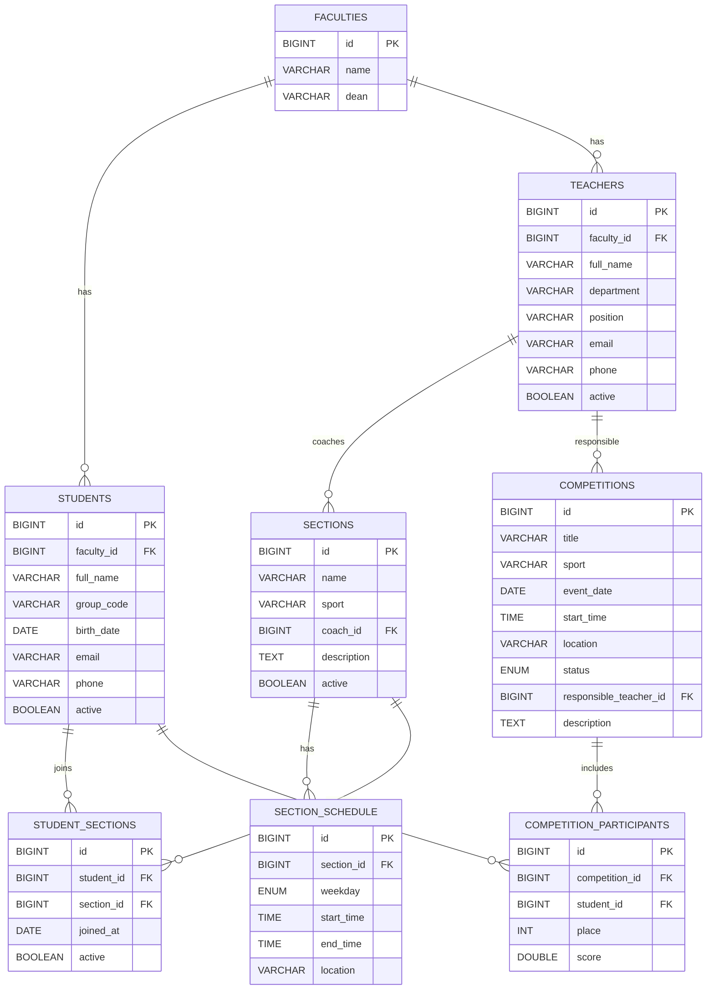
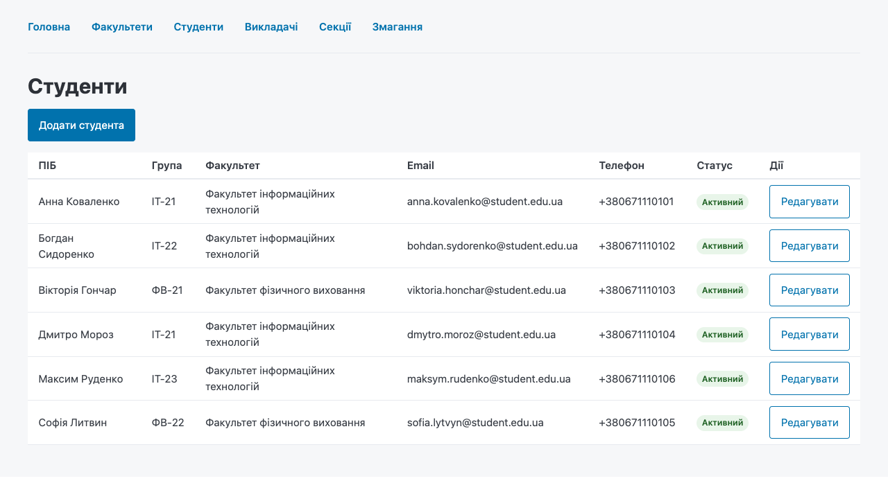
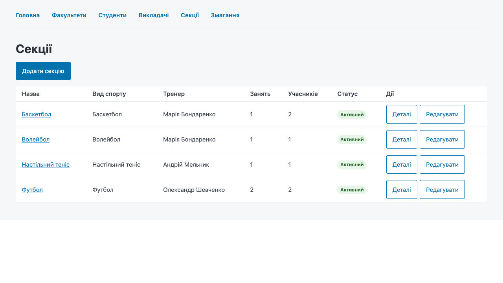
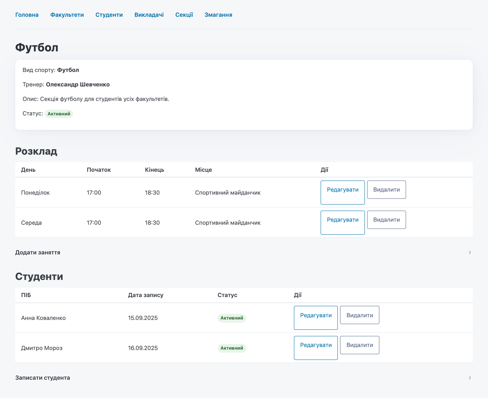
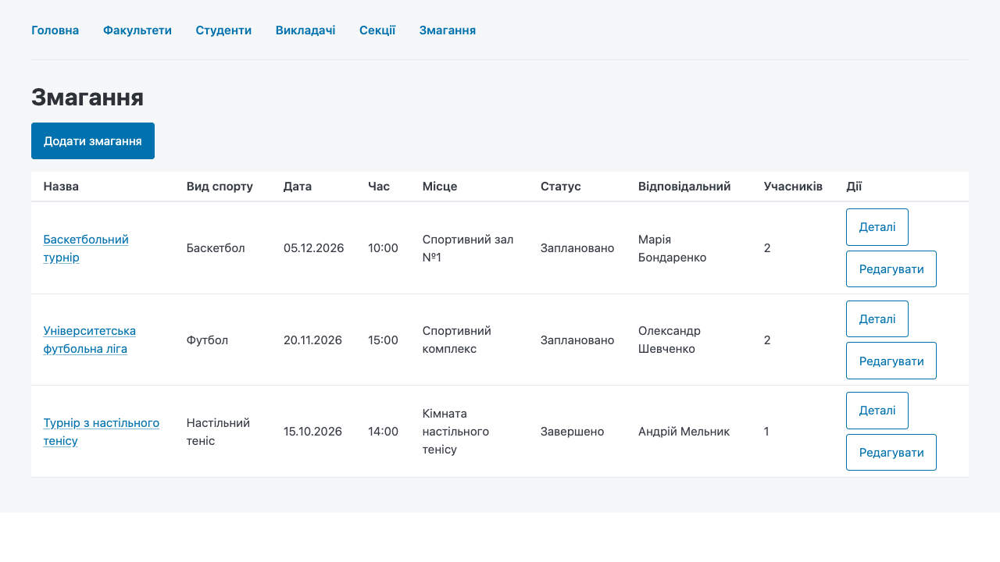
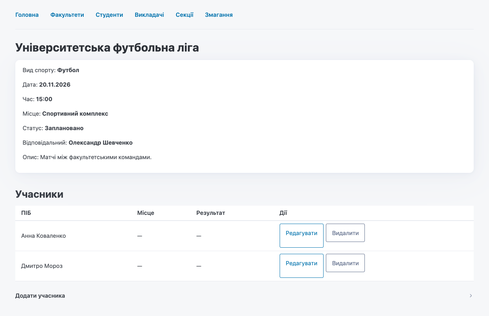
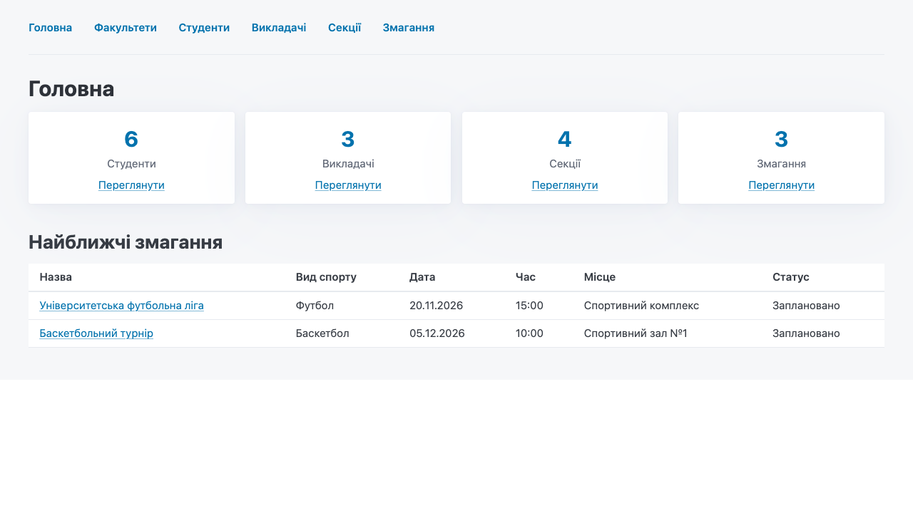

# Спорт на факультеті

Лабораторна робота №1: інформаційна система на Haskell + MySQL з веб-інтерфейсом.

Система зберігає інформацію про студентів, викладачів, спортивні секції, графік їх роботи та план змагань, а також дозволяє додавати й коригувати ці дані через браузер.

## Варіант та ідея

**Варіант:** інформаційна система «Спорт на факультеті».

Ідея — зробити не просто набір таблиць, а невеликий робочий довідник спортивного життя факультету. Викладач може бути тренером секції або відповідальним за змагання, студент — записатися до секції та взяти участь у змаганні. Для секції зберігається розклад занять, для змагання — план проведення, статус і результати учасників.

Дані пов'язані між собою так, щоб основні питання можна було отримати з БД без дублювання інформації:

- які секції існують і хто ними керує;
- коли проходять заняття кожної секції;
- які студенти займаються в якій секції;
- які змагання заплановані та хто за них відповідає;
- хто брав участь у змаганні та з яким результатом.

## Можливості

- Дашборд з кількістю студентів, викладачів, секцій і змагань та найближчими змаганнями.
- Довідник факультетів.
- CRUD для студентів і викладачів.
- CRUD для спортивних секцій.
- Розклад секції: додавання, редагування, видалення занять.
- Запис студентів у секції та редагування участі.
- План змагань: додавання, редагування, відповідальний викладач, статус.
- Учасники змагань: місце, результат, редагування, видалення.
- Серверна валідація форм і зрозумілі повідомлення про помилки.
- Обробка конфліктів БД (дублікати, порушення зовнішніх ключів) з HTTP 409.
- HTML-екранування через `blaze-html`; SQL — параметризований.
- Примусово світла тема інтерфейсу, незалежно від теми браузера.

## Як виконано вимоги лабораторної

| Вимога | Реалізація |
|---|---|
| Програма на Haskell | GHC 9.6.7, Cabal, весь застосунок написаний на Haskell |
| Використати `classes` і `instances` | власний клас `Entity` у `src/DB/Entity.hs` та 8 instances у `src/DB/Instances.hs`; додатково використано клас `Field` з `mysql-haskell` |
| Використати MySQL | MySQL 8.0 у Docker Compose, драйвер `mysql-haskell`, пул з'єднань `resource-pool` |
| Кількість таблиць > 5 | 8 таблиць: `faculties`, `students`, `teachers`, `sections`, `section_schedule`, `student_sections`, `competitions`, `competition_participants` |
| Інформація про студентів і викладачів | таблиці `students`, `teachers`, зв'язки з факультетами та секціями |
| Студенти займаються у спортивних секціях | таблиця `student_sections` із датою запису та активністю участі |
| Графік роботи секцій | таблиця `section_schedule` з днем тижня, часом початку/завершення та місцем |
| План проведення змагань | таблиця `competitions` зі статусом, датою, часом, місцем і відповідальним викладачем |
| Можливість запровадження та коригування інформації | CRUD-сторінки та POST-обробники для всіх основних сутностей; окремі сторінки редагування розкладу, участі й учасників змагань |
| Зручний інтерфейс | мінімальний server-rendered web UI на Scotty + `blaze-html`, без окремого frontend-застосунку |

## Стек

- GHC 9.6.7 + Cabal 3.12.
- `scotty` — веб-сервер.
- `blaze-html` — серверний HTML.
- `mysql-haskell` — чистий Haskell-драйвер MySQL (без `libmysqlclient`).
- `resource-pool` — пул з'єднань.
- MySQL 8.0 у Docker.
- Pico.css — мінімальний CSS.

## Архітектура

```text
Web (Scotty + blaze-html)
        │
        ▼
Application / Validation
        │
        ▼
Persistence (Entity + Repository)
        │
        ▼
MySQL
```

Доменні типи не залежать від web або MySQL. `Entity` описує мапінг сутності на рядок БД, а узагальнений repository виконує CRUD. Web-хендлери залишаються тонкими: розібрати форму → викликати repository → відрендерити сторінку або зробити redirect.

Основні модулі:

```text
app/Main.hs              — запуск застосунку, пул з'єднань
src/Config.hs            — конфігурація з environment variables
src/Domain/Model.hs      — доменні типи та enum-и
src/Domain/Validation.hs — чисті парсери/валідатори
src/DB/Entity.hs         — клас Entity
src/DB/Instances.hs      — instances для 8 сутностей
src/DB/Repository.hs     — узагальнений CRUD
src/DB/Queries.hs        — join-запити для списків і деталей
src/Web/Forms.hs         — парсинг HTML-форм
src/Web/Views.hs         — HTML-сторінки
src/Web/App.hs           — маршрути та хендлери
sql/001_schema.sql       — схема БД
sql/002_seed.sql         — тестові дані
static/                  — CSS і favicon
scripts/smoke.sh         — smoke-перевірка HTTP-маршрутів
test/Spec.hs             — чисті тести валідації та Entity
```

### Чому саме така архітектура

- **Functional core / imperative shell.** Домен, валідація та мапінг рядків БД є чистими функціями. IO, HTTP і MySQL зосереджені на межі застосунку.
- **Домен не знає про MySQL і HTML.** `Domain.Model` не імпортує ані `mysql-haskell`, ані `blaze-html`. Це дозволяє тестувати логіку без бази й браузера.
- **Один клас замість восьми майже однакових репозиторіїв.** `Entity` описує лише те, що відрізняється між сутностями: назву таблиці, колонки, id, перетворення в рядок і з рядка. Узагальнений `DB.Repository` виконує `findAll`, `findById`, `insert`, `update`, `delete`.
- **Помилки як значення.** Замість `error`/`fromJust` використовується `Either AppError a`. Помилки валідації, відсутні записи, конфлікти унікальності та помилки БД мають окремі конструктори.
- **Явні SQL-запити для join-ів.** Generic CRUD не намагається «вгадати» складні зв'язки: списки з назвами факультетів, тренерів і кількістю учасників написані явно в `DB.Queries`.
- **Мінімум магії.** Немає free monads, effect systems або надскладного transformer-стеку; для лабораторної достатньо `ReaderT`-подібного оточення на рівні застосунку та явного `Either`.

### Основні маршрути

| Метод | Шлях | Призначення |
|---|---|---|
| GET | `/` | дашборд і найближчі змагання |
| GET | `/faculties` | список факультетів |
| GET/POST | `/faculties/new`, `/faculties/:id` | створення та редагування факультету |
| GET | `/students` | список студентів |
| GET/POST | `/students/new`, `/students/:id` | створення та редагування студента |
| GET | `/teachers` | список викладачів |
| GET/POST | `/teachers/new`, `/teachers/:id` | створення та редагування викладача |
| GET | `/sections` | список секцій |
| GET/POST | `/sections/new`, `/sections/:id` | створення та редагування секції |
| GET | `/sections/:id` | деталі секції, розклад, студенти |
| POST | `/sections/:id/schedule` | додати заняття |
| GET/POST | `/schedule/:id/edit`, `/schedule/:id` | редагувати заняття |
| POST | `/schedule/:id/delete` | видалити заняття |
| POST | `/sections/:id/students` | записати студента в секцію |
| GET/POST | `/memberships/:id/edit`, `/memberships/:id` | редагувати участь |
| POST | `/memberships/:id/delete` | видалити участь |
| GET | `/competitions` | список змагань |
| GET/POST | `/competitions/new`, `/competitions/:id` | створення та редагування змагання |
| GET | `/competitions/:id` | деталі змагання та учасники |
| POST | `/competitions/:id/participants` | додати учасника |
| GET/POST | `/participants/:id/edit`, `/participants/:id` | редагувати учасника |
| POST | `/participants/:id/delete` | видалити учасника |
| GET | `/health` | перевірка доступності застосунку |

## ER-діаграма



Усього 8 таблиць, тобто вимога «більше 5» виконана.

| Таблиця | Що зберігає |
|---|---|
| `faculties` | факультети та деканів |
| `students` | студентів, групу, контакти, активність |
| `teachers` | викладачів, кафедру, посаду, контакти |
| `sections` | спортивні секції та тренера |
| `section_schedule` | графік занять секції |
| `student_sections` | запис студентів у секції |
| `competitions` | план змагань, дату, місце, статус |
| `competition_participants` | учасників змагань, місця та результати |

## Швидкий старт

Потрібні Docker Desktop, GHC і Cabal. Якщо GHC/Cabal ще не встановлені:

```bash
curl --proto '=https' --tlsv1.2 -sSf https://get-ghcup.haskell.org | sh
export PATH="$HOME/.ghcup/bin:$PATH"
```

Запуск:

```bash
# 1. MySQL 8 + схема + seed-дані
docker compose up -d
docker compose ps

# 2. Перше оновлення індексів Hackage і збірка
cabal update
cabal build

# 3. Запуск веб-застосунку
cabal run sport-faculty
```

Відкрити: <http://localhost:3000>

Перевірка:

```bash
cabal test          # чисті тести
./scripts/smoke.sh  # 21 HTTP-маршрут
```

## Конфігурація

Застосунок читає environment variables. Значення за замовчуванням збігаються з `docker-compose.yml`:

| Змінна | За замовчуванням |
|---|---|
| `DB_HOST` | `127.0.0.1` |
| `DB_PORT` | `3306` |
| `DB_NAME` | `sport_faculty` |
| `DB_USER` | `sport_user` |
| `DB_PASSWORD` | `sport_pass` |
| `PORT` | `3000` |

Приклад є у `.env.example`. Для локальної лаби пароль можна не змінювати; для реального розгортання — обов'язково.

## Тема інтерфейсу

Інтерфейс примусово використовує світлу тему. У `<html>` виставлено `data-theme="light"`, у `<head>` — `color-scheme: light`, а в CSS — `color-scheme: light` для `:root` та `html`. Тому заголовки, картки, таблиці й нативні контроли форм не змінюються, навіть якщо в браузері або системі увімкнена темна тема.

Це перевірено Playwright з `prefers-color-scheme: dark`: обчислені кольори залишаються світлими. Див. `screenshots/07-dark-browser-forced-light.png`.

## Демо-сценарій

1. Відкрити дашборд — видно 6 студентів, 3 викладачі, 4 секції, 3 змагання.
2. `Студенти` → додати студента, відредагувати email.
3. `Викладачі` → додати викладача.
4. `Секції` → створити секцію, вибрати тренера.
5. Відкрити секцію → додати заняття в розклад, записати студента.
6. `Змагання` → створити змагання, відкрити його, додати учасника з місцем і результатом.
7. Оновити сторінку / перезапустити сервер — дані зберігаються в MySQL.

## Класи та instances

Центральний клас:

```haskell
class Entity a where
  tableName :: Proxy a -> Text
  columns   :: Proxy a -> [Text]
  entityId  :: a -> Int64
  toRow     :: a -> [MySQLValue]
  fromRow   :: [MySQLValue] -> Either AppError a
```

Instances зроблені для:

- `Faculty`
- `Student`
- `Teacher`
- `Section`
- `ScheduleEntry`
- `StudentSection`
- `Competition`
- `CompetitionParticipant`

Клас описує лише мапінг на БД, без IO та HTML. Для окремих полів використовується клас `Field` з `mysql-haskell`, а для параметрів — `QueryParam`. Orphan instances зібрані в одному адаптерному модулі `DB.Instances` і позначені `-Wno-orphans`, щоб домен не залежав від MySQL.

## Тестування

Перевірено на цій машині:

- `cabal build` — успішно.
- `cabal test` — 16 чистих тестів:
  - валідація обов'язкових полів;
  - парсинг дат і часу;
  - перевірка часового діапазону;
  - валідація форм студента/факультету;
  - roundtrip `fromRow (id : toRow x)` для `Student`, `Section`, `Competition`, `CompetitionParticipant`;
  - відмова `fromRow` для неправильної кількості колонок.
- `./scripts/smoke.sh` — 21 маршрут повертає `200`.
- Playwright:
  - створення та редагування студента;
  - створення викладача;
  - створення секції, додавання розкладу й учасника;
  - створення змагання й учасника;
  - редагування факультету, викладача, секції, змагання;
  - редагування та видалення розкладу, участі й учасника;
  - перевірка збереження даних після перезапуску сервера;
  - перевірка примусово світлої теми при `prefers-color-scheme: dark`;
  - відсутність помилок у консолі браузера.
- SQL-перевірки: 8 таблиць, 9 зовнішніх ключів, seed-дані.

## Скріншоти

### Дашборд


### Студенти



### Секції



### Деталі секції: розклад і студенти



### Змагання



### Деталі змагання: учасники



### Темна тема браузера не змінює інтерфейс



## Скидання бази

```bash
docker compose down -v
docker compose up -d
```

`down -v` видаляє volume з даними й повторно запускає `sql/001_schema.sql` та `sql/002_seed.sql`. Це destructive-команда.

## Обмеження

- Немає авторизації та ролей — застосунок розрахований на локальний запуск.
- Немає пагінації та пошуку.
- Основні сутності не видаляються жорстко; для них є прапорець `active`.
- Немає CSRF-захисту. Якщо розгортати публічно, його треба додати разом з авторизацією.
- Час зберігається як локальний; контейнер MySQL налаштований на `Europe/Kyiv`.

## macOS: якщо GHC не лінкується

На macOS 27 з Xcode 26.5 і GHC 9.6.7 можлива помилка:

```text
ld: ... tapi error: malformed file
... unknown architecture arm64e.x1-macos ...
```

Це конфлікт між SDK Command Line Tools і Xcode. Можна вказати GHC на SDK Xcode:

```bash
XCODE_SDK=/Applications/Xcode.app/Contents/Developer/Platforms/MacOSX.platform/Developer/SDKs/MacOSX.sdk
sed -i '' "s#/Library/Developer/CommandLineTools/SDKs/MacOSX.sdk#$XCODE_SDK#g" \
  ~/.ghcup/ghc/9.6.7/lib/ghc-9.6.7/lib/package.conf.d/rts-1.0.2.conf \
  ~/.ghcup/ghc/9.6.7/lib/ghc-9.6.7/lib/package.conf.d/ghci-9.6.7.conf
ghc-pkg recache
```

Після цього `cabal build` має проходити.
